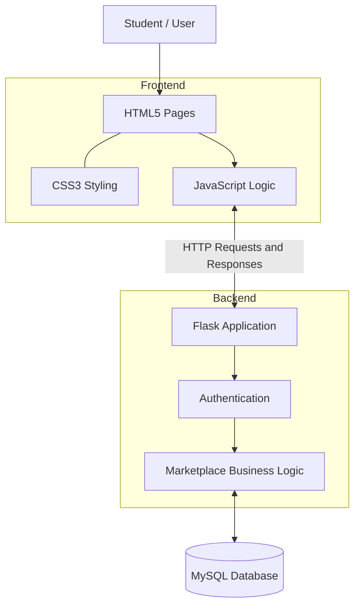
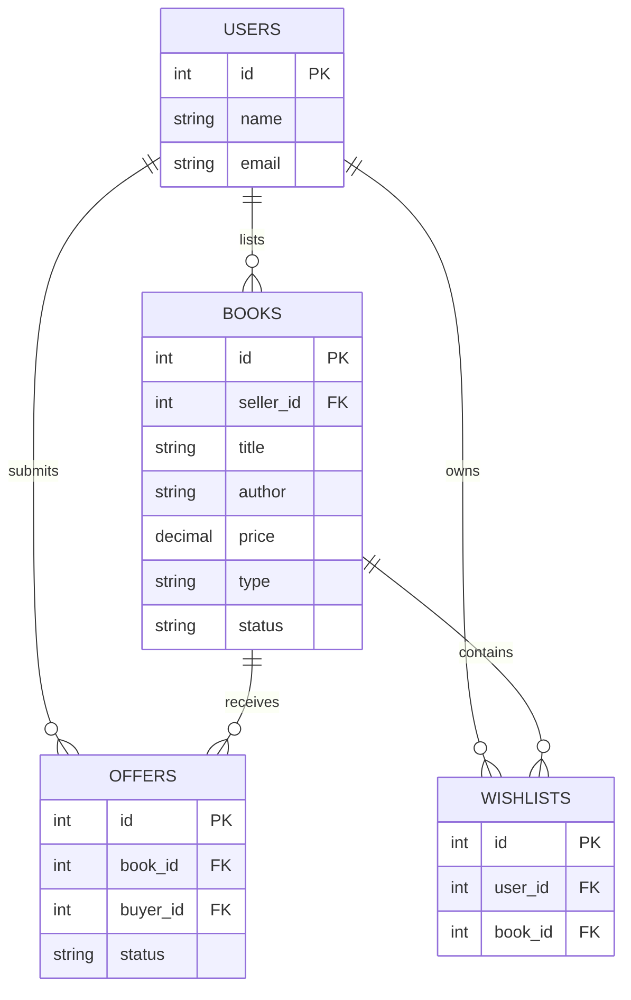

# BookLoop
### Campus Book Marketplace

BookLoop is a student-focused web application for buying, selling, exchanging, and donating used academic books. Built with HTML, CSS, JavaScript, Flask, and MySQL, it helps students discover books, publish listings, manage offers, and save books to their wishlists.

## Features

- **User Authentication** — Login and registration interface for student accounts.
- **Book Discovery** — Browse available books and view individual book details.
- **Listing Management** — Publish academic books with descriptions, conditions, prices, and transaction types.
- **Search and Filtering** — Find relevant books through the available discovery interface.
- **Offer Management** — Submit offers and manage incoming offers with acceptance or rejection.
- **Buy, Exchange, and Donate** — Support multiple ways to reuse academic books.
- **Wishlist** — Save books for future reference.
- **Dashboard** — View personal listings and marketplace activity.
- **User Profiles** — Access profile information.
- **Wanted Books** — Dedicated interface for wanted-book functionality.
- **MySQL Database** — Persistent storage for users, listings, offers, and wishlist relationships.
- **Responsive UI** — Dark-themed interface with reusable styling and interactive components.

## Prerequisites

| Tool | Version | Notes |
|---|---|---|
| Python | Python 3 | Backend runtime |
| pip | Compatible version | Python package management |
| MySQL | Compatible server version | Database service |
| Git | Latest stable | Repository management |
| Web Browser | Modern browser | Application interface |

## Quick Start

### 1. Clone the Repository

```bash
git clone https://github.com/PrabhakarRavichandran/BookLoop.git
cd BookLoop
```

### 2. Create a Virtual Environment

```bash
python -m venv .venv
```

Activate on Windows PowerShell:

```powershell
.\.venv\Scripts\Activate.ps1
```

### 3. Install Dependencies

If `requirements.txt` exists:

```bash
pip install -r requirements.txt
```

Otherwise, inspect `backend/app.py` and install the required packages. The documented stack includes Flask, Flask-CORS, and mysql-connector-python, subject to the actual imports.

### 4. Configure MySQL

Start your local MySQL server and create the database if it is not already created by the schema:

```sql
CREATE DATABASE bookloop;
```

Import the schema:

```powershell
mysql -u YOUR_DB_USER -p bookloop < .\backend\schema.sql
```

Replace `YOUR_DB_USER` with your MySQL username.

### 5. Start the Application

From the project root:

```bash
python run.py
```

Alternatively, on Windows:

```powershell
.\start_server.bat
```

Open the local URL printed by the server. If configured for port 5000, the address is:

`http://127.0.0.1:5000`

## Architecture

```text
BookLoop/
├── backend/
│   ├── app.py              # Flask backend and application routes
│   └── schema.sql          # MySQL schema and seed data
│
├── css/
│   └── style.css           # Application styling and design system
│
├── js/
│   └── app.js              # Shared JavaScript and frontend logic
│
├── images/                 # Static images and assets
│
├── index.html              # Application entry point
├── login.html              # Login and registration
├── dashboard.html          # User activity dashboard
├── explore.html             # Browse book listings
├── book.html                # Individual book details
├── sell.html                # Create book listings
├── offers.html              # Manage offers
├── wishlist.html            # Saved books
├── profile.html             # User profile
├── wanted.html              # Wanted-book interface
│
├── run.py                   # Local application launcher
├── start_server.bat         # Windows startup script
└── README.md                # Project documentation
```

## System Architecture



### Application Modules

| Module | Responsibility |
|---|---|
| Authentication | Manage account access and sessions |
| Book Discovery | Browse and search book listings |
| Book Details | Display individual book information |
| Listing Management | Create and manage book listings |
| Offer Management | Submit and review offers |
| Wishlist | Save and manage preferred books |
| Dashboard | Summarize user activity |
| Profile | Display user information |
| Wanted Books | Support wanted-book functionality |
| Backend | Process requests and business rules |
| Database | Persist application data |

## Database Design

The documented database uses four core entities:

- **users** — Student account and profile information.
- **books** — Book listings, ownership, transaction types, and status.
- **offers** — Offers submitted for book listings.
- **wishlists** — Associations between users and saved books.

### Entity Relationship Diagram



The diagram represents the conceptual data model. Refer to `backend/schema.sql` for the exact column definitions, constraints, and relationships.

## API Reference

The Flask backend handles the application's HTTP requests. The following table describes the functional API areas; exact routes and methods should be verified against `backend/app.py`.

| Module | Operations |
|---|---|
| Authentication | Registration, login, logout |
| Books | List, retrieve, create, update, and delete listings |
| Offers | Create offers, list offers, update offer status |
| Wishlist | Retrieve, add, and remove saved books |
| Profile | Retrieve and manage supported profile information |
| Dashboard | Retrieve user activity and listing information |

## Usage Workflow

1. **Access the Application** — Open BookLoop and sign in or register.
2. **Explore Books** — Browse available academic books and open their details.
3. **Publish a Listing** — Use the Sell page to provide book information and select a transaction type.
4. **Submit an Offer** — Select a book and use its supported offer functionality.
5. **Manage Offers** — Review incoming offers and accept or reject eligible requests.
6. **Save Books** — Add interesting books to the wishlist.
7. **Track Activity** — Use the Dashboard to review personal marketplace activity.

## Testing

Test the main application workflows before deployment.

- Application startup and database connectivity.
- Authentication and session handling.
- Book listing creation and validation.
- Book discovery and details.
- Offer creation and status updates.
- Listing ownership and authorization.
- Wishlist operations.
- Dashboard and profile behavior.
- Error handling and invalid inputs.

No automated test count is specified because the current test suite and execution results have not been verified.

## Development Notes

- The frontend uses HTML5, CSS3, and vanilla JavaScript.
- Flask provides the backend application and HTTP routing.
- MySQL is used for relational data storage.
- `backend/schema.sql` contains the documented database schema and potentially seed data.
- `run.py` and `start_server.bat` provide local startup options.
- Database credentials must remain private and should not be committed to GitHub.
- Protected operations should be validated and authorized on the backend.
- Integrated payments, delivery tracking, and real-time notifications should not be assumed unless separately implemented.

## Future Enhancements

- Advanced book search and filtering.
- Improved listing and offer status tracking.
- Notifications for offer updates.
- Enhanced accessibility and mobile responsiveness.
- Automated API and integration tests.
- Improved security and production deployment configuration.
- Pagination and performance optimization for larger collections.

## Project Summary

BookLoop provides a centralized platform for students to discover and reuse academic books through buying, selling, exchanging, and donating.

The project demonstrates full-stack development concepts involving frontend interfaces, Flask backend development, REST-style communication, relational database design, authentication, listing management, and marketplace workflows.

**Repository:** https://github.com/PrabhakarRavichandran/BookLoop

**Tech Stack:** HTML5, CSS3, JavaScript, Python, Flask, MySQL.
